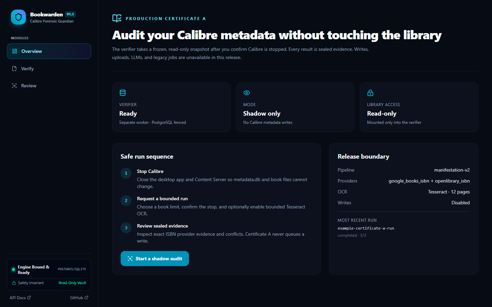
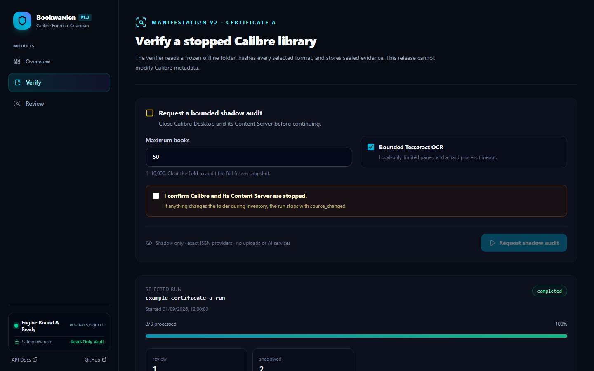

# Calibre Bookwarden


**Find uncertain Calibre metadata before you change it.** Bookwarden inspects the
formats attached to a book, compares evidence from the files and exact-ISBN
sources, and records why a proposed identity is strong, weak, or unresolved.
It is self-hosted and designed to keep the operator in control.

[GitHub mirror CI](https://github.com/felixapel/calibre-bookwarden/actions/workflows/ci.yml) ·
[Latest release](https://github.com/felixapel/calibre-bookwarden/releases/latest) ·
[Documentation](#documentation) ·
[Contributing](CONTRIBUTING.md) ·
[GPL-3.0-or-later](LICENSE)

> [!IMPORTANT]
> The supported production profile is **Certificate A**: verification and
> evidence review against a **stopped Calibre library**, mounted read-only
> into a separate verifier. It does not apply metadata or cover changes.
> Publishing an image does not mean a homelab installation has passed the
> [deployment gates](docs/production-readiness.md).

## See the interface

These are captures of the actual Certificate A web UI with **synthetic example
data**, not results from a private library or a production deployment.

| Overview | Bounded verification |
| :--- | :--- |
| [](docs/assets/certificate-a-overview.png) | [](docs/assets/certificate-a-verify.png) |

The screenshots can be regenerated from the static UI with
`webui/scripts/capture-readme-screenshots.mjs`; its API data is deliberately
synthetic.

## What it does

- **Inspect formats and identity evidence.** Manifestation V2 hashes attached
  formats, checks readable content, and separates exact-ISBN evidence from
  weaker hints. OCR and provider results can inform a review but cannot
  authorize a correction by themselves.
- **Explain uncertainty.** Sealed evidence records source details, conflicting
  claims, identity tiers, and proposed shadow differences for human review.
- **Audit a stopped library locally.** The CLI reports SQLite integrity,
  missing files, title and author-sort anomalies, duplicate candidates, and
  cover diagnostics without changing the library.
- **Keep production writes outside the boundary.** Certificate A has no Calibre
  writer, file upload, auto-apply, or remote text/image disclosure. Experimental
  and historical code in this repository is not a production entrypoint.

## Try a local read-only audit

Use a trusted checkout and a **stopped library or disposable restored copy**.
Do not point the development CLI at a live Calibre or Calibre-Web library.

```sh
uv sync --frozen
uv run bookwarden audit-360 --library "/path/to/stopped-or-restored-library"
```

The output may contain private titles and paths; keep it local. Full file and
cover inspection needs the supported Linux secure-file path. Windows currently
supports metadata-only inspection and fails closed for legacy file/cover reads.
See [installation](INSTALL.md), the [CLI reference](CLI_REFERENCE.md), and the
[disposable Calibre lab](docs/runbooks/disposable-calibre-lab.md).

## Deploy Certificate A

The supported Linux/Docker Compose deployment runs a separate verifier,
PostgreSQL, Valkey, and a minimal web/API image. Only the verifier mounts the
stopped library, read-only. Images must be selected by the **immutable digest**
from the matching release's `release-images.json`, then validated against the
same source revision and environment.

Follow [installation](INSTALL.md) and the
[production operations runbook](docs/runbooks/production-operations.md). There
is currently **no validated one-click Unraid or TrueNAS template** for this
profile. Do not use a single-container legacy template as Certificate A.

## Release and security status

Gitea is the canonical development and integration forge; GitHub is the public
mirror and image publisher. The [v1.3.2 release record](docs/releases/v1.3.2.md)
defines its exact-revision evidence and residual risks. A green CI badge or an
older run does not certify a later commit, an image, or a homelab deployment.

The optional Prometheus 3.13.3 LTS monitoring image retains two known HIGH
gRPC findings under a **time-bounded, image-specific exception**. Its review
deadline is 2026-10-16; see [ADR-011](docs/decisions/ADR-011-prometheus-lts-publication-exception.md).
No zero-risk or perfect-accuracy claim is made.

Please report security issues privately through the repository's
[security policy](SECURITY.md). Do not attach real library databases, book
files, credentials, or unredacted audit output to public issues.

## Documentation

- [Installation and prerequisites](INSTALL.md)
- [Usage](USAGE.md) and [CLI reference](CLI_REFERENCE.md)
- [Architecture](ARCHITECTURE.md) and [decisions](docs/decisions/)
- [Production operations](docs/runbooks/production-operations.md) and
  [readiness gates](docs/production-readiness.md)
- [Testing](TESTING.md) and [contributing](CONTRIBUTING.md)
- [Roadmap](ROADMAP.md)

## Support and license

Development is supported through [GitHub Sponsors](https://github.com/sponsors/felixapel)
and [Ko-fi](https://ko-fi.com/felixapel). Bookwarden is licensed under
[GPL-3.0-or-later](LICENSE).
